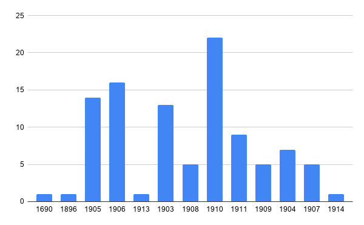
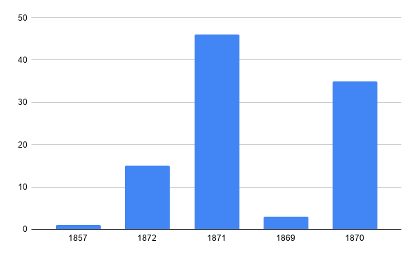

# tdse-tp4-adc

1. Colocar el punto medio del potenciómetro en PA0 y los otros dos en 3V3 y GND.
2. Ajustar el potenciónmetro aproximadamente en la mitad de la posición.
3. Forkear el repositorio y abrir el proyecto en STM32CubeIDE.
4. Conectar la placa NUCLEO-F103RB.
5. Analizar la configuración del ADC1 configurado, sin modificarla.

El valor de tensión del potenciometro medido vía multímetro es entre 1800 mV y 1900 mV.

## Test 1
6. Volver al código y configurar el primer test, verificando la directiva `#define TEST_NUMBER` (línea 18 de `app.c`), es decir que diga `#define TEST_NUMBER TEST_1`.
7. Compilar y debuggear. En la consola deben listarse 100 muestras.
8. Obtener la media y el desvío estándar. Se puede usar cualquier herramienta, por ejemplo Excel, GCalc, [We Do Data Science](https://www.wedodatascience.com), ...

Media_empirírica = 1904,85
desvío_estandar = 21,91 (hay una muestra muy lejana, si se desestima da 3.05)

## Test 2
9. Volver al código y configurar el segundo test, mediante la directiva `#define TEST_NUMBER TEST_2`.
10. Compilar y debuggear. En la consola deben listarse 100 muestras.
11. Obtener la media y el desvío estándar y comparar resultados.

Media_empirírica = 1870,60
desvío_estandar = 1.56 

## Test 3
12. Volver al código y configurar el tercer test, mediante la directiva `#define TEST_NUMBER TEST_3`.
13. Compilar y debuggear. En la consola deben listarse 100 muestras.
14. Comparar esta implementación con la del primer test.

media_empirica = 1864,79
desvio_estandar= 18,37

